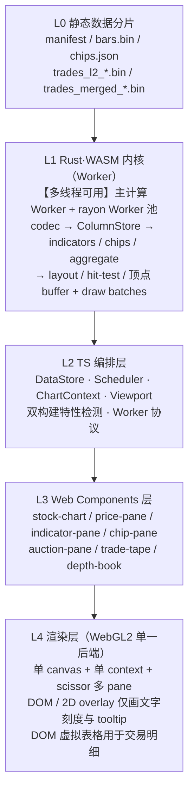

# 股票图表组件 · 架构与 Rust 性能方案设计（第三期）

> 初稿：2026-11-15 ｜ 决策确认修订：2026-11-16 ｜ **多线程启用修订：2026-11-16**
> 承接：`01-历史行情数据格式调研.md`（数据结构与数据源）、`02-扩展数据类型与Level2调研.md`（多副图、筹码峰、集合竞价、Level2、B/S/C）。
> 本期任务：**自行实现 1 个以上 Web 组件**，把前两期全部数据需求统一收进一套架构，性能相关部分用 **Rust → WebAssembly** 实现。
> 本文为技术方案，不含任何投资建议。文中性能数字均为**设计估算**，需实测验证。

> **文档定位与现状说明**
> 本文为第三期**方案设计**，Rust/WASM 多线程、列式存储、`ts-rs` 类型生成、Cargo 工程结构与拟定 API 均为**规划、尚未落地**。当前为纯 TS 工程：`JsComputeEngine` + `src/algorithms/` 18 单元 + `src/architecture/` 四层架构 + 9 个公开标签 + 两个 Container；`src/data/` 5 键驱动（bars/intraday/auction/depth/orders）、5 个数据集运行时派生（chips/intradayMulti/depthFull/depthScenarios/trades，逐笔明细不再落盘）；落盘 bars 保持东财 push2his 原生 11 列映射，演示四态由 `manifest.demoPatterns` 在内存叠加。文中 L0–L4 是**方案分层编号**，与 `docs/00` 数据分层 L0/L1/L2 不同义。概念定义以 `docs/00` 为准。

**变更记录**

- **2026-11-16 第一次修订**：固化 6 项决策 —— Web Components、**渲染后端直接上 WebGL2**、**L2 双来源**、**筹码峰 9 项/150 档双模式可切换**、**不做 SSR**、**浅色主题单一基线**；当时 COOP/COEP 暂不纳入。
- **2026-11-16 第二次修订（本次）**：用户确认**部署环境可以设置 COOP/COEP**。方案从「单线程唯一路径」改为「**多线程可用 + 双构建自动降级**」：重写 §6.3 Worker 拓扑、新增 §6.4 并行性分析、新增 §11.2 部署配置清单，并同步修订 §0、§1、§2、§3.3、§4.2、§5、§7、§8、§9、§10、§11.1、§12、§13。

---

## 0. 方案摘要（关键决策）

> （方案规划，非已实现）

| # | 决策 | 理由 |
|---|---|---|
| 1 | 组件形态用 **Web Components（Custom Elements）**，React/Vue 只做薄封装 | 已确认；自研组件库要跨框架复用，渲染不走 DOM 树 |
| 2 | **自研 WebGL2 渲染器，直接上，不做 Canvas2D 兜底** | 已确认；几何全部 GPU 绘制，文字用 DOM / 2D overlay；前两期图表库契约只作字段参考，不作运行时依赖 |
| 3 | **Rust → WASM 跑在 Web Worker**，主线程只做 DOM / 事件 / 调度 / GL 提交 | 解析、指标、筹码峰、L2 聚合都是 CPU 密集且数据量大 |
| 4 | 数据用**列式（SoA）TypedArray** 存在 WASM 线性内存，导出 `ptr + len` 零拷贝视图 | 避免 JS 对象数组与 GC 抖动 |
| 5 | 拆成 **7 个组件**（P0 必选 3 个 / 扩展 3 个 / 可选 1 个） | 满足「一个以上」，且把不同坐标系的面板解耦 |
| 6 | **WASM 多线程可用**：`rayon` + `wasm-bindgen-rayon` + Worker 池；**双构建 + 运行时特性检测自动降级** | 已确认部署环境支持 COOP/COEP；带 atomics 的 WASM 在不支持环境无法实例化，必须准备单线程构建 |
| 7 | 静态数据分片 + **构建期预计算**（筹码峰、指标聚合） | 契合「只看历史」；运行时零重计算 |
| 8 | Rust 结构体是**类型唯一真源**，用 `ts-rs` / `typeshare` 生成 TS 类型 | 防止 Rust 侧与 TS 侧数据结构漂移 |
| 9 | **L2 双来源**：授权逐笔 + 公开 3 秒合并分笔，统一归一化 | 已确认两种都要；必须显式标注 `granularity` 与授权状态 |
| 10 | **筹码峰双模式**：9 项统计指标 / 150 档直方图，运行时可切换 | 已确认；共用一份 `ChipDataset`，不重复请求 |
| 11 | **浅色主题单一基线**，A 股红涨绿跌 | 已确认；不做深色与欧美配色 |
| 12 | **不做 SSR / 首屏骨架** | 已确认；Custom Elements 直接在客户端初始化 |
| 13 | **并行只用于可切分的任务**，递推指标保持串行 | 见 §6.4；盲目 `par_iter` 会把 EMA/MACD 算错 |

### 0.1 决策确认记录

| 决策点 | 用户确认 | 方案落位 |
|---|---|---|
| 组件形态 | **Web Components** | §3 组件清单、§3.5 框架薄封装 |
| 渲染后端 | **直接上 WebGL2** | §5.1 WebGL2 渲染管线 |
| L2 数据来源与授权 | **两种都需要** | §4.4 双来源适配、§6.1 分片、§10 合规 |
| 筹码峰深度 | **9 项和 150 档都要，可切换** | §4.5 `ChipDataset`、`<chip-pane mode>` |
| SSR / 首屏骨架 | **不需要** | 删除 SSR 适配与相关风险条目 |
| 主题与涨跌颜色 | **浅色主题** | §3.6 固定色板 |
| **COOP/COEP** | **部署环境可以支持** | §6.3 多线程启用、§6.4 并行性分析、§11.2 部署配置清单 |

---

## 1. 设计约束回溯：前两期结论如何变成架构要求

| 前两期结论 | 对架构的硬要求 | 本方案落位 |
|---|---|---|
| 字段顺序有 `O,C,H,L` / `O,H,L,C` / `O,C,L,H` 三种 | 归一化必须在**一处**完成 | `market-codec`（Rust）统一解析 |
| 量单位「手 vs 股」、额单位「元 vs 千元」、数值全字符串 | 解析时一次性转成数值 + 统一单位 | `ColumnStore` 只存「股 / 元」 |
| 时间有秒 / 毫秒 / 日期字符串 | 统一 UTC 毫秒 + 独立 `tradeDate` | `timestamps: Vec<f64>` + `trade_dates: Vec<u32>` |
| 29 万根 1 分钟 K 线 / 5 年；L2 单日 GB 级 | 不能把对象数组塞进 JS 堆 | 列式内存 + 视口裁剪 + 降采样 |
| 筹码峰 150 档 × N 日，是建模估算 | 计算密集且可离线完成 | `market-chips`（Rust）+ 构建期预生成 |
| 多副图共享 x 轴、十字光标联动 | 单一 viewport 真源 + 广播 | `<stock-chart>` 持有 `ChartContext` |
| 筹码峰与主图共享价格 y 轴 | 跨 pane 价格轴同步 | `ChartContext.priceScale` |
| 集合竞价 9:15–9:25 独立时间轴、「价有量无」 | 不能塞进 240 点分时数组 | 独立 `<auction-pane>` |
| B/S/C 语义随市场/供应商/表而变 | 归一化值 + 原值 + 来源三者都保留 | `side / rawSide / sideSource` |
| 交易明细需要虚拟滚动 | 表格只渲染可见行 | Rust 窗口查询 + `<trade-tape>` |
| 前复权会使历史价随时间变化 | 数据集锁定单一复权口径 | `manifest.adjust`，切换整体重载 |
| 新增：WebGL2 单页 context 有上限 | 不能每个 pane 一个 canvas | §5.1 单 context + scissor 分区 |
| 新增：L2 两种来源粒度不同 | 同一组件要能区分并标注 | §4.4 `L2Provider` + `granularity` |
| 新增：COOP/COEP 可支持 | 多线程可用，但需双构建兜底 | §6.3、§11.2 |

---

## 2. 总体分层架构

> （方案规划，非已实现）



职责原则：**Rust 管「数据 + 算 + 布局 + 顶点生成」，TS 管「DOM + 事件 + GL 提交 + 调度」**。WASM 不直接操作 DOM，也不逐条调用 WebGL API。**多线程只加速 Worker 内的计算，不改变渲染架构**：GL 提交仍在主线程。

---

## 3. 组件拆分与公共 API

### 3.1 组件清单（共 7 个）

| 组件 | 标签 | 职责 | 主要消费数据 | 阶段 |
|---|---|---|---|---|
| 根容器 | `<stock-chart>` | 编排 pane、**持有唯一 WebGL2 context**、viewport/priceScale、crosshair 广播、复权、数据加载 | `ChartDatasetV2` / `manifest` | **P0** |
| 主图 | `<price-pane>` | K 线 / 分时切换、蜡烛与折线、价格轴、标记 | `Bar[]` / `IntradayPoint[]` | **P0** |
| 通用副图 | `<indicator-pane>` | VOL / AMOUNT / MACD / KDJ / RSI / BOLL / 量比 / 资金流 | `PaneSeries` | **P0** |
| 筹码峰 | `<chip-pane>` | **双模式**：9 项统计指标 / 150 档横向柱；与主图共享 priceY；火焰山分层 | `ChipDataset` | P2 |
| 集合竞价 | `<auction-pane>` | 9:15–9:25 独立轴、虚拟撮合价、匹配/未匹配量 | `AuctionPoint[]` | P2 |
| 交易明细 | `<trade-tape>` | 虚拟滚动、B/S/C 着色、**双来源与粒度徽标**、与 crosshair 联动 | `TradeTick[]` 分页 | P3 |
| 十档盘口 | `<depth-book>` | 十档深度、快照回放 | `DepthSnapshot[]` | P3（可选） |

> 当时规划 7 个组件；当时 8 个公开标签（新增 `<detail-canvas>`）、当前 9 个（再新增 stock-workspace）

> P0 即 **3 个独立组件**，满足「一个以上」；完整方案 7 个。pane 类需挂在 `<stock-chart>` 内，`<trade-tape>` / `<depth-book>` 可独立使用（通过 `context` 属性注入）。

> 以下为拟定 API，尚未全部落地；当前以 `src/elements/stock-chart.ts` 为准

### 3.2 声明式用法

```html
<stock-chart
  symbol="600519.SH"
  market="CN"
  timezone="Asia/Shanghai"
  adjust="qfq"
  interval="1d"
  dataset="/data/600519.SH/manifest.json"
  renderer="webgl2"
  theme="light">

  <price-pane mode="candle" height="58%"></price-pane>
  <indicator-pane indicator="VOL" height="12%"></indicator-pane>
  <indicator-pane indicator="AMOUNT" height="10%"></indicator-pane>
  <indicator-pane indicator="MACD" height="14%"></indicator-pane>
  <chip-pane width="140px" dock="right" mode="histogram"></chip-pane>
</stock-chart>

<auction-pane context="chart-1" phase="open"></auction-pane>
<trade-tape context="chart-1" page-size="200" source="auto"></trade-tape>
```

`source="auto"` 由 `manifest.l2.providers` 决定优先使用授权逐笔还是公开合并分笔；也可显式指定 `exchange` / `public-merged`。

> 以下为拟定 API，尚未全部落地；当前以 `src/elements/stock-chart.ts` 为准

### 3.3 根容器 `<stock-chart>` API

**属性**

| 属性 | 类型 | 说明 |
|---|---|---|
| `symbol` | string | 标准代码，如 `600519.SH` |
| `market` / `timezone` | string | 决定交易时段、日历、涨跌颜色 |
| `adjust` | `'none' \| 'qfq' \| 'hfq'` | **必填，不设默认值**；切换触发整体重载 |
| `interval` | `'1m'…'1d' \| '1w' \| '1M'` | 周期 |
| `dataset` | string \| `ChartDatasetV2` | manifest URL 或已注入的数据对象 |
| `renderer` | `'webgl2'` | **固定单一后端**；不提供 Canvas2D 切换 |
| `theme` | `'light'` | **固定浅色主题**；不提供深色切换 |

**方法**

| 方法 | 说明 |
|---|---|
| `setDataset(data)` | 注入归一化数据集（触发重算与重绘） |
| `setViewport({startIndex, endIndex})` | 编程式缩放/平移 |
| `addPane(element)` / `removePane(id)` | 动态增删副图 |
| `setIndicator(paneId, name, params?)` | 切换副图指标 |
| `setChipMode(mode)` | 切换筹码峰 `stat` / `histogram` |
| `setL2Source(kind)` | 切换 L2 来源 `exchange` / `public-merged` |
| `getComputeMode()` | 返回 `'threaded' \| 'single'`，供调试与监控 |
| `exportImage(type)` | 导出 PNG（重绘到离屏后取像素） |
| `destroy()` | 释放 WASM 内存、Worker 池、GL 资源、事件监听 |

**事件（CustomEvent）**

`data-loaded` / `viewport-change` / `crosshair-change` / `bar-hover` / `pane-ready` / `chip-mode-change` / `l2-source-change` / **`compute-mode-change`**（含 `mode`、线程数、降级原因）/ `webglcontext-lost` / `error`。

### 3.4 组件间通信

- 根容器创建 **`ChartContext`**：`{ viewport, priceScale, xScale, crosshairIndex, palette, gl, store, wasm }`；子 pane 通过 `closest('stock-chart')?.context` 获取，或外部用 `context` 属性注入。
- **viewport 单一真源**：`{startIndex, endIndex, priceMin, priceMax}` 只存于根容器，所有 pane 只读。
- **crosshair**：根容器派发 `crosshair-change`，各 pane 订阅同一个 `index`。
- **GL 资源单一真源**：唯一 `WebGL2RenderingContext`、shader program、VBO 均由根容器创建，pane 只向 `RenderQueue` 提交绘制批次。
- **计算模式单一真源**：双构建选择结果存在 `ChartContext.computeMode`，供 UI 显示与埋点。

### 3.5 框架适配

- `@stock-chart/react`、`@stock-chart/vue` 仅做属性 → props、CustomEvent → emit 的映射，**不参与渲染**。
- 提供 `JSX.IntrinsicElements` 类型声明。
- **不做 SSR / 首屏骨架**：Custom Elements 直接在客户端初始化，无需水合占位与服务端标签输出。

### 3.6 固定浅色色板

| 用途 | 颜色 | 说明 |
|---|---|---|
| 背景 / 面板 | `#FFFFFF` / `#F7F8FA` | 浅底深字 |
| 网格线 | `#ECEEF1` | 细网格 |
| 主文字 / 次要文字 | `#1F2329` / `#6B7280` | 刻度、图例 |
| **涨（阳线 / 主动买）** | `#E24B4A` | 红涨，符合 A 股习惯 |
| **跌（阴线 / 主动卖）** | `#1D9E75` | 绿跌 |
| 均价线 | `#F0A020` | 分时均价 |
| 十字光标 | `#8A94A6` | 虚线 |
| 筹码：获利 / 套牢 | `#F5A623` / `#4A90D9` | 火焰山可再按时间分层 |
| 中性成交 `N/M` | `#9AA3AF` | 灰色 |

色板常量在 TS 侧定义，构建顶点时以 packed RGBA 传入 Rust；不保留深色分支。（当时规划；现状几何与色板均在 TS 侧并已提供多主题）

---

## 4. 统一数据结构落位

### 4.1 前两期类型 → 存储形态 → 生产/消费

| 类型（来源） | 运行时存储形态 | 生产者 | 消费者 |
|---|---|---|---|
| `Bar`（一期） | `ColumnStore` 列式数组 | `market-codec`（Rust） | `price-pane` / `indicator-pane` |
| `IntradayPoint`（一期） | 列式数组（分时模式） | `market-codec` | `price-pane` |
| `PaneSeries`（二期） | Rust 指标缓存 `HashMap<String, Vec<f32>>` | `market-indicators` | `indicator-pane` |
| **`ChipDataset`（本期扩展）** | 静态 JSON（构建期生成，含多日） | `market-chips` + CLI | `chip-pane` 双模式 |
| `AuctionPoint`（二期） | 独立数组 | `market-codec` | `auction-pane` |
| `TradeTick`（二期） | **双来源分页列式二进制** | `ExchangeL2Adapter` / `PublicMergedAdapter` | `trade-tape` |
| `OrderTick` / `DepthSnapshot`（二期） | 分页列式二进制 | 同上 | `depth-book` |
| `ChartDatasetV2`（二期） | `manifest.json` + 分片索引 | 构建期 CLI | `DataStore` |

> 前两期文档里的 TS interface **继续作为对外 API 契约**；Rust 内部结构是它的列式实现，两者由自动生成的类型保证一致。

### 4.2 列式内存模型（Rust）

```rust
#[wasm_bindgen]
pub struct ColumnStore {
    len: usize,
    timestamps: Vec<f64>,      // UTC 毫秒
    trade_dates: Vec<u32>,     // YYYYMMDD 紧凑整型
    open:  Vec<f32>,
    high:  Vec<f32>,
    low:   Vec<f32>,
    close: Vec<f32>,
    pre_close: Vec<f32>,
    volume: Vec<f64>,          // 统一「股」
    amount: Vec<f64>,          // 统一「元」
    turnover_rate: Vec<f32>,
    adj_factor: Vec<f32>,
    indicators: HashMap<String, Vec<f32>>,
}
```

零拷贝导出（JS 侧 `new Float32Array(wasm.memory.buffer, ptr, len)`）：

```rust
#[wasm_bindgen]
impl ColumnStore {
    pub fn close_ptr(&self) -> *const f32 { self.close.as_ptr() }
    pub fn close_len(&self) -> usize { self.close.len() }
    pub fn memory(&self) -> JsValue { wasm_bindgen::memory() }
}
```

> ⚠️ 基于 `wasm.memory.buffer` 的视图在 **WASM 内存增长后会失效**；多线程构建使用 shared memory 且由 `--max-memory` 固定上限（见 §6.3），**更不能动态增长**。约定：**加载阶段一次性预分配固定容量，加载完成后不再分配**；若必须 grow，重建所有视图并广播 `memory-resized`。shared memory 下 `buffer` 为 `SharedArrayBuffer`，视图类型不变但生命周期约束同样适用。

### 4.3 跨边界契约（性能红线）

1. **批量调用**，禁止「每根 K 线一次 JS→WASM 调用」。
2. 解析入参用 `&[u8]`，**不用 `String`**。
3. 大结果返回 `ptr + len`，或写入调用方预分配的输出 buffer。
4. 类型由 `market-types` 单一真源 + `ts-rs` 生成 TS 声明，CI 校验一致性。
5. **共享内存下不跨线程传递 JS 对象**，只传 `ptr + len` 与数值参数；结果写回共享 buffer 后由主 Worker 统一返回。

### 4.4 L2 双来源适配（已确认）

```ts
type L2SourceKind = 'exchange' | 'public-merged';
type Granularity  = 'tick' | 'merged3s';

interface L2Provider {
  kind: L2SourceKind;
  granularity: Granularity;
  license: 'authorized' | 'public-demo';
  label: string;
  decode(bytes: ArrayBuffer): TradeTick[];
}
```

| 适配器 | 输入 | 方向字段 | `granularity` | 授权 |
|---|---|---|---|---|
| `ExchangeL2Adapter` | 上交所 `Tick.csv` / 深交所 STEP 逐笔、授权数据商二进制 | `TradeBSFlag` B/S/N、`ExecType` 4/F、`Side` 1/2/G/F、`BuyNo/SellNo/BizIndex` | `tick` | `authorized` |
| `PublicMergedAdapter` | 东财 `details`（方向码 `1/2`）、腾讯 `detail`（`B/S/M`） | `rawSide` 原值 + 供应商映射 | `merged3s` | `public-demo` |

统一到第二期定义的 `TradeTick`，并**强制**保留：`granularity`、`side`（归一 B/S/N）、`rawSide`、`sideSource`、`license`、`tradeCount`（合并分笔才有）。

约束：`<trade-tape>` 必须显示来源徽标与粒度；资金流副图按来源标注口径；**集合竞价成交一律排除**；`manifest.l2.providers` 声明来源与授权；构建期 CLI 按 `license` 过滤，授权数据不随公开静态站点分发。

### 4.5 筹码峰双模式数据（已确认）

> 当时草案；当前字段见 `src/types.ts` 的 `ChipDataset` / `ChipHistogram`（无 `prices`/`ageLayers`）

```ts
interface ChipDataset {
  symbol: string;
  adjust: 'none' | 'qfq' | 'hfq';
  dates: string[];                    // 支持历史某日回放
  stats: ChipStat[];                  // 9 项统计指标，按日
  histograms: ChipHistogram[];        // prices[150] + ratios[150]，按日
  ageLayers?: Float32Array;           // 可选：火焰山时间分层
}
```

- `<chip-pane mode="stat">`：9 项指标面板 + 主图价格轴上的 90/70 成本区间带。
- `<chip-pane mode="histogram">`：150 个 quad 横向柱，WebGL2 一次 draw call；颜色区分获利/套牢或按 `ageLayers` 分层。
- **切换不重新请求数据**：共用同一份 `ChipDataset`，`setChipMode()` 只改渲染路径。
- 历史回放按 `tradeDate` 索引预生成；体积估算 `150 × 2 × 8 B × 250 日 ≈ 600 KB / 标的 / 年`（估算）。
- 与主图共享 `priceScale`；`adjust` 与根容器不一致时禁止渲染并提示重载。

---

## 5. Rust 与 TS 的职责边界

> （方案规划，非已实现）

| 任务 | 归属 | 理由 |
|---|---|---|
| 各源字符串数组 / CSV / UDF / L2 双来源解析归一化 | **Rust** | 一次转换，避免 JS 对象数组与 GC |
| 列式存储、分片索引、窗口查询 | **Rust** | 连续内存、二分检索 |
| 指标计算：MACD / KDJ / RSI / BOLL / CCI / DMI / OBV / 量比 / 资金流 | **Rust** | O(n) 数值循环，SIMD128 友好 |
| **可并行任务的 rayon 切分与归并**（见 §6.4） | **Rust** | 只在 Worker 池内并行 |
| 筹码峰：150 档三角形分布 + 换手率衰减 + 双模式产物 | **Rust** | 计算密集，构建期预生成 |
| L2 逐笔/合并分笔聚合、B/S 分档、时间桶 | **Rust** | 数据量最大 |
| 视口裁剪、min/max 或 LTTB 降采样 | **Rust** | 只输出像素级点数 |
| 坐标系变换、hit-test、**顶点 buffer 与 draw batches 生成** | **Rust** | 高频交互路径 |
| Custom Elements 生命周期、属性反射 | TS | WASM 不擅 DOM |
| **双构建特性检测、Worker 池初始化** | TS | 浏览器能力判断属宿主层 |
| 指针事件、tooltip、文字刻度、虚拟表格 DOM、a11y | TS | 同上 |
| **WebGL2 context / shader / VBO 管理与 GL 提交** | TS | 避免 WASM 持有浏览器对象生命周期 |
| 数据加载调度、缓存、Worker 消息协议 | TS | 编排职责 |
| 浅色色板、配置、错误上报 | TS | 同上 |

### 5.1 WebGL2 渲染管线（已确认为主路径）

**单 context + scissor 多 pane**：整个 `<stock-chart>` 只有 **1 个 `<canvas>` 和 1 个 `WebGL2RenderingContext`**。每个 pane 通过 `gl.viewport` + `gl.scissor` 划分矩形区域后提交绘制批次。依据：浏览器对单页 WebGL context 数量有上限（桌面常见 16、Android 约 8），超出会丢弃最旧 context 导致空白。

**Rust 产出（零拷贝交给 TS）**：

```rust
#[repr(C)]
pub struct Vertex {
    pub x: f32, pub y: f32,
    pub r: f32, pub g: f32, pub b: f32, pub a: f32,
}

#[repr(C)]
pub struct DrawBatch {
    pub mode: u8,        // 0 TRIANGLES / 1 TRIANGLE_STRIP / 2 POINTS
    pub first: u32,
    pub count: u32,
    pub pane_id: u8,
    pub scissor: [u16; 4],
}

pub struct FrameGeometry {
    pub vertices: Vec<Vertex>,
    pub batches: Vec<DrawBatch>,
}
```

TS 侧：`gl.bufferData(...)` 一次上传 → 遍历 batches 设 scissor → `gl.drawArrays(...)`。一次边界传输、少量 draw call。

**图元策略**：

| 图形 | 图元 | 说明 |
|---|---|---|
| K 线实体、成交量柱、成交额柱、筹码峰横条、网格 | `TRIANGLES` | 主体几何 |
| 影线、分时线、均价线、均线、MACD 线 | `TRIANGLE_STRIP` / 三角形化 | ⚠️ 多数 WebGL 实现 `ALIASED_LINE_WIDTH_RANGE=[1,1]`，`gl.lineWidth()` 静默无效；由 Rust 在 CPU 侧沿法线把线段扩展成窄四边形 |
| 逐笔散点 | `POINTS` | 注意 `ALIASED_POINT_SIZE_RANGE` 上限 |

**Shader**：一个正交投影 2D program（像素坐标 → NDC），顶点色 + uniform 色板；K 线可选 `drawArraysInstanced`。

**文字与坐标轴（混合层）**：价格刻度、时间标签、图例、tooltip 用透明 DOM 层或 2D canvas overlay 绘制，**不进 WebGL**（WebGL 无平台文字栈，需自做字形光栅化/纹理图集，DPR 缩放下清晰度更差）。DOM 只承载文字与交互，不承载几何。

**运行时约定**：按需渲染（无变化不跑常驻 rAF loop，空闲零 GPU 工作）、`devicePixelRatio` 换算、`webglcontextlost/restored` 重建 program/VBO、离屏重绘导出图片。

### 5.2 交互帧路径

```text
pointermove（主线程算像素 x）
  → postMessage({type:'hitTest', x})
  → Rust 二分定位 index + 计算 crosshair 数据
  → 返回 → 根容器派发 crosshair-change（index/timestamp/price/bar）
  → 各 pane 用同一 index 更新光标几何与文字 overlay
  → requestRender() 置脏 → rAF 合帧 → 上传顶点 + scissor 提交 draw batches
```

---

## 6. 数据流与加载策略

### 6.1 静态分片目录

> 以下为规划的静态分片方案；当前 src/data 仅 5 个 JSON + manifest，5 类数据集运行时派生

```text
/data/600519.SH/
  manifest.json                          # symbol / market / timezone / adjust / session
                                         #  / floatShares / tradeDates / source / updatedAt
                                         #  / l2.providers[] / palette=light / 分片索引 + 校验和
  bars_1d.bin
  bars_1m_2026.bin
  intraday_20261113.bin
  chips（运行时派生，已删除同名落盘文件）
  auction_20261113.json
  trades_l2_20261113_p0001.bin           # 授权逐笔（tick），按 license 决定是否分发
  trades_merged_20261113_p0001.bin       # 公开 3 秒合并分笔（merged3s）
  depth_20261113.bin
```

**只有历史、无实时端点**。

### 6.2 三层加载

| 层 | 内容 | 时机 |
|---|---|---|
| 主图层 | `bars` / `intraday` 列式二进制 | 首屏一次性加载 |
| 聚合层 | `chips` / `auction` / 指标结果 | 按交易日加载 |
| 明细层 | `trades_l2_*` / `trades_merged_*` / `depth` 分页 | 视口进入时按需分页，Worker 解码后 transfer `ArrayBuffer` |

### 6.3 Worker 拓扑与多线程启用（本次重写）

> （方案规划，非已实现）

用户已确认部署环境可以设置 COOP/COEP，因此**启用 WASM 多线程**，但采用官方推荐的 **双构建 + 运行时特性检测**，保证任何环境都能运行。

#### 6.3.1 两层 Worker 拓扑

- **主线程**：DOM + 交互 + WebGL2 提交 + 调度，永不跑重计算。
- **Layer 1 · 主计算 Worker**（1 个）：持有 WASM 实例与 `ColumnStore`，处理 `decode / compute / layout / query`；**UI 线程保护**靠这一层，与是否多线程无关。
- **Layer 2 · rayon Worker 池**（N 个）：由 `wasm-bindgen-rayon` 把 `par_iter` 映射到 Web Worker，共享同一份 `WebAssembly.Module` 与 shared memory，做并行计算。
- 线程数建议 `min(navigator.hardwareConcurrency, 8)`，避免过度订阅；可通过 `compute-mode-change` 事件观测实际值。

#### 6.3.2 双构建与特性检测（官方推荐路径）

带 atomics 的 WASM 模块在不支持线程的环境**无法实例化**，因此必须产出两份构建：

```text
pkg-threads/   # nightly + atomics + shared-memory + rayon
pkg-single/    # stable + 普通单线程（功能完全一致）
```

```js
import { threads } from 'wasm-feature-detect';

let wasmPkg, mode = 'single', reason = '';
if (crossOriginIsolated && await threads()) {
  wasmPkg = await import('./pkg-threads/index.js');
  await wasmPkg.default();
  await wasmPkg.initThreadPool(Math.min(navigator.hardwareConcurrency, 8));
  mode = 'threaded';
} else {
  wasmPkg = await import('./pkg-single/index.js');
  await wasmPkg.default();
  reason = !crossOriginIsolated ? 'no-cross-origin-isolation' : 'threads-unsupported';
}
dispatchEvent(new CustomEvent('compute-mode-change', { detail: { mode, reason } }));
```

> 只用 `crossOriginIsolated` 判断还不够：浏览器可能支持 SAB 但不支持 WASM threads，所以用 `wasm-feature-detect` 补一道检测。

#### 6.3.3 线程版编译配置（一手资料）

`rust-toolchain.toml`（**固定 nightly 版本**，降低工具链漂移风险）：

```toml
[toolchain]
channel = "nightly-2025-11-15"
components = ["rust-src"]
targets = ["wasm32-unknown-unknown"]
```

`.cargo/config.toml`：

```toml
[target.wasm32-unknown-unknown]
rustflags = [
  "-C", "target-feature=+atomics,+bulk-memory",
  "-C", "link-arg=--shared-memory",
  "-C", "link-arg=--max-memory=1073741824",
  "-C", "link-arg=--import-memory",
  "-C", "link-arg=--export=__wasm_init_tls",
  "-C", "link-arg=--export=__tls_size",
  "-C", "link-arg=--export=__tls_align",
  "-C", "link-arg=--export=__tls_base"
]
[unstable]
build-std = ["panic_abort", "std"]
```

构建命令：`wasm-pack build --target web`（**必须 `--target web`**，因为线程需要共享 `WebAssembly.Module` 给子 Worker）。单线程版用 stable 工具链 + `wasm-pack build --release --target web`。Rust 侧只需 `pub use wasm_bindgen_rayon::init_thread_pool;` 重导出，计算代码照常写 `par_iter()`。

> `--max-memory=1073741824` 固定 shared memory 上限 **1 GB**，与 §4.2「加载期预分配固定容量」的约定一致；单只标的 29 万根 1 分钟线约 25 MB、L2 分片按需加载，远低于上限。

#### 6.3.4 部署侧配置清单

COOP/COEP 是**服务器响应头**，不是前端代码。生产 Nginx：

```nginx
add_header Cross-Origin-Opener-Policy "same-origin" always;
add_header Cross-Origin-Embedder-Policy "require-corp" always;
```

本地开发（Vite，**`server` 与 `preview` 都要配**，否则构建预览会意外降级）：

```ts
// vite.config.ts
export default defineConfig({
  server:  { headers: { 'Cross-Origin-Opener-Policy': 'same-origin',
                        'Cross-Origin-Embedder-Policy': 'require-corp' } },
  preview: { headers: { 'Cross-Origin-Opener-Policy': 'same-origin',
                        'Cross-Origin-Embedder-Policy': 'require-corp' } },
});
```

**跨源隔离的连带约束**：页面加载的所有第三方资源都必须带 `Cross-Origin-Resource-Policy: cross-origin` 或正确 CORS 头，否则加载失败；嵌入 iframe 时父页面也要同样设置。同源的 WASM、Worker 脚本、静态数据分片不受影响。

**验证方法**：DevTools Network 查看两个响应头；控制台 `crossOriginIsolated === true` 且 `typeof SharedArrayBuffer !== 'undefined'`；组件派发的 `compute-mode-change` 显示 `mode='threaded'`。

**降级路径**：内置预览服务、普通静态托管、未配头的环境 → 自动加载 `pkg-single`，功能完全一致，仅吞吐下降；`compute-mode-change` 会带 `reason` 便于排查。

### 6.4 并行性分析（关键：不是所有计算都能并行）

| 任务 | 可并行性 | 说明 |
|---|---|---|
| 多标的批量解析 / 归一化 | ✅ 按标的 `par_iter` | 收益最大，彼此独立 |
| 多副图的不同指标（VOL 与 MACD 与 KDJ） | ✅ 按指标 `par_iter` | 各自独立 |
| min/max 降采样 | ✅ 按像素列分桶 | 每桶独立，归并简单 |
| L2 逐笔按时间桶 / 金额档聚合 | ✅ 分片后归并 | 注意分片边界的桶合并 |
| 筹码峰多标的批量预计算 | ✅ 按标的 | 构建期 CLI，天然可并行 |
| **EMA / MACD（DIF、DEA）** | ❌ **单序列串行递推** | 依赖前值，直接 `par_iter` 会算错 |
| KDJ / RSI 的平滑递推 | ❌ 串行 | 同上 |
| 累计成交量/额、均价（前缀和） | ⚠️ 需并行前缀扫描 | 普通 `par_iter` 不适用 |
| 筹码分布逐日衰减（存量 ×(1-换手率)） | ❌ 时序依赖 | 按日不能简单并行，只能按标的并行 |
| WebGL2 GL 提交 | ❌ 主线程专属 | 与 WASM 线程无关 |

> **结论**：多线程收益主要在「多标的 / 多分片 / 多指标 / 降采样 / L2 聚合」，**单只股票单序列的 MACD 收益有限**。并行化必须按任务粒度设计，禁止对整个指标计算函数无脑 `par_iter`；递推类指标加单元测试锁死结果，与单线程构建对拍验证。

---

## 7. 性能预算（设计估算，需实测）

| 场景 | 数据规模 | 目标 | 手段 |
|---|---|---|---|
| 首屏日线 | ~4,840 根 / 20 年 | 解码 + 首帧 < 100 ms（不含网络） | 列式二进制、构建期预计算、单 context |
| 1 分钟线 | ~29 万根 / 5 年 | 内存 < 25 MB | f32 列式 + 视口裁剪 + min/max 降采样 |
| pan / zoom | 视口 200–800 根 | 60 fps | 只提交视口顶点、单 bufferData、rAF 合帧、按需渲染 |
| 全量 MACD（单序列串行） | 29 万点 | < 20 ms | Rust O(n) + SIMD128 |
| **多标的批量指标（并行）** | 100 只 × 日线 | 相对单线程 **2–4×**（估算，取决于核数） | rayon 按标的切分 |
| **L2 逐笔聚合（并行）** | 百万条 / 分片 | < 50 ms（估算） | 按时间桶分片 + 归并 |
| 筹码峰 | 150 档 × 250 日 | 运行时 0 计算；切换 < 1 帧 | 构建期预生成、双模式共用数据 |
| L2 明细 | 单日 GB 级 | 表格只渲染可见 ~50 行 | 分页 + 虚拟滚动 + Rust 窗口查询 |
| WebGL2 | 7 个 pane | **1 个 context**、每帧十余次 draw call | scissor 分区 + batch 合并 |
| WASM 体积 | 双构建 | 单份 < 600 KB gzip（估算） | `wasm-opt -Oz`、feature 裁剪、**按需动态 import 只加载一份** |

> 所有毫秒数、加速比、体积均为**设计目标，不是实测结果**；P4 用 `criterion` + 浏览器压测页在「线程版 / 单线程版」两套构建上分别验证并对比。

---

## 8. 工程结构（方案规划，非当前仓库）

> 当前实现为 src/ + scripts/ + docs/

```text
stock-chart/
  rust-toolchain.toml              # 固定 nightly（线程版构建用）
  .cargo/config.toml               # atomics / shared-memory / build-std
  Cargo.toml                       # workspace + features
  crates/
    market-types/                  # 【类型唯一真源】+ ts-rs 导出 TS
    market-codec/                  # 东财 / 腾讯 / 新浪 / Alpha Vantage / UDF
    market-codec-l2/               # ExchangeL2Adapter + PublicMergedAdapter
    market-store/                  # ColumnStore、分片索引、窗口查询
    market-indicators/             # 指标（标注哪些可并行、哪些串行）
    market-chips/                  # 150 档分布 + 9 项统计 + 火焰山
    market-layout/                 # viewport、坐标系、hit-test
    market-render/                 # Vertex / DrawBatch / 三角形化线段
    market-wasm/                   # wasm-bindgen 绑定 + init_thread_pool 重导出
  packages/
    core/                          # DataStore / Scheduler / ChartContext / Worker 协议
    boot/                          # 【双构建特性检测】wasm-feature-detect + initThreadPool
    gl/                            # WebGL2 context、shader、VBO、scissor、context-lost
    overlay/                       # DOM / 2D 文字刻度、tooltip、色板
    elements/                      # 7 个 Custom Elements
    react/  vue/                   # 薄封装（不含渲染、不含 SSR）
    cli/                           # 构建期：抓取 → 归一化 → 分片 + 预计算 + license 过滤
  pkg-threads/  pkg-single/        # 两份 wasm-pack 产物
  examples/                        # 静态样例数据 + 演示页（两种模式都可跑）
  benches/                         # criterion + 浏览器压测页（双构建对比）
```

Cargo features：`simd128`（默认）、`webgl2`（默认）、`threads`（**线程版构建开启**）。构建脚本需跑两次：nightly + atomics 产 `pkg-threads/`，stable 产 `pkg-single/`；CI 锁定 `rust-toolchain.toml` 的 nightly 版本。bundler 推荐 Vite（官方注明开箱支持 WASM 线程 Worker 打包；Webpack 5.25.1+ / Parcel 2 亦可）。

---

## 9. 实施路线（按多线程可用调整）

| 阶段 | 交付 | 验收标准 |
|---|---|---|
| **P0** | `market-types` / `codec` / `store` / `market-render`；**WebGL2 单 context + scissor 管线**；`<stock-chart>` + `<price-pane>` + `<indicator-pane>`（VOL、MACD）；浅色色板；静态样例日线 | 日 K + 2 副图由单 context 绘制；文字 overlay 清晰；crosshair 联动；拖拽 60 fps；单位/复权口径正确 |
| **P1** | 分时模式 + 量比 / 成交额 / KDJ；Worker + 列式二进制；**双构建 + 特性检测**；rayon 并行化「多标的 / 多指标 / 降采样」；构建期 CLI | 线程版与单线程版**计算结果逐字段一致**；29 万点缩放不卡顿；`compute-mode-change` 正确上报 |
| **P2** | `<chip-pane>` 双模式切换 + `<auction-pane>`；价格轴对齐；火焰山分层 | 9 项统计与 150 档切换不重新请求；筹码峰与主图同步缩放；竞价「价有量无」正确 |
| **P3** | `<trade-tape>` + `<depth-book>` + 资金流副图；**L2 双来源适配**；B/S/C 归一化；明细分页；**L2 聚合并行分片** | 两种来源均可加载并显示粒度徽标；虚拟滚动流畅；字段可追溯；集合竞价成交不计入资金流 |
| **P4** | **多线程压测与线程数调优**、降级路径验证、部署响应头与第三方 CORP 审计、上下文丢失恢复、instanced K 线、a11y、文档 | 第 7 节预算达标；未配头环境自动降级且功能不缺失；递推指标与单线程版对拍一致 |

每个阶段仍产出可独立运行的示例页与静态样例数据，且**示例页必须在线程版与单线程版下都能跑**。

---

## 10. 关键风险与取舍

| 风险 | 说明 | 缓解措施 |
|---|---|---|
| **带 atomics 的 WASM 无法在不支持环境实例化** | 不是「跑得慢」，是根本加载不了 | **双构建 + `wasm-feature-detect` 特性检测**；默认可降级到 `pkg-single` |
| **COOP/COEP 连带约束** | 开启后第三方字体/脚本/图片 CDN 必须带 CORP/CORS；iframe 需父页面同设 | 部署前审计 Network 面板；不满足的资源改同源或代理；Vite `server` 与 `preview` 都配头 |
| **nightly 工具链漂移** | `build-std` 需 nightly，版本升级可能破坏构建 | `rust-toolchain.toml` 固定版本；CI 锁定；升级前跑双构建回归 |
| **shared memory 上限固定** | `--max-memory=1GB`，grow 会使所有视图失效 | 加载期预分配固定容量；数据集总量控制在上限内；禁止运行时 grow |
| **并行误用导致指标算错** | EMA/MACD/KDJ 递推、筹码衰减有时序依赖，`par_iter` 会出错 | §6.4 明确任务分类；递推指标保持串行；单线程/线程版逐字段对拍 |
| **双构建体积与维护成本** | 产物翻倍、两套工具链 | 按需动态 import 只加载一份；类型与业务逻辑共用同一套 crate |
| **WebGL context 上限** | 桌面常见 16 / Android 约 8，超出丢弃最旧 | 全局单 context + scissor；`destroy()` 显式释放；监听 lost/restored |
| **线宽只有 1px** | `ALIASED_LINE_WIDTH_RANGE=[1,1]` | Rust CPU 侧把线段三角形化 |
| **WebGL 文字渲染** | 需字形光栅化，清晰度差 | 文字走 DOM / 2D overlay |
| **内存增长使视图失效** | TypedArray 视图绑定 `wasm.memory.buffer` | 预分配固定容量；grow 后重建并广播 |
| **跨边界开销抵消收益** | 逐条调用 / 传 `String` 有拷贝 | 批量 + `&[u8]` + `ptr/len` + 顶点 buffer |
| **自研渲染成本高** | 坐标轴、hit-test、缩放都要自己实现 | P0 只做最小渲染器；坐标系与 hit-test 放 Rust 复用 |
| **Rust / TS 类型漂移** | 双份结构容易不同步 | `ts-rs` 生成 TS，CI 校验 |
| **调试困难** | WASM panic 信息少、线程问题更难复现 | `console_error_panic_hook`、source map、`wasm-bindgen-test`、`compute-mode-change` 埋点 |
| **L2 双来源合规与口径混用** | 授权数据需采购；两种粒度不可混算 | `license` 字段 + 构建期过滤；UI 标注粒度；一次只用一种来源 |
| **复权口径** | 筹码峰、量比、资金流都受复权影响 | 数据集锁定单一 `adjust`，不一致时禁止渲染 |

> 已删除原「Web Components SSR」风险条目（确认不需要 SSR）。

---

## 11. 决策确认记录与部署说明

### 11.1 已确认决策汇总

| # | 决策点 | 结果 |
|---|---|---|
| 1 | 组件形态 | **Web Components** |
| 2 | 渲染后端 | **直接上 WebGL2** |
| 3 | L2 数据来源与授权 | **授权逐笔 + 公开 3 秒合并分笔，两种都要** |
| 4 | 筹码峰深度 | **9 项统计 + 150 档直方图，运行时可切换** |
| 5 | SSR / 首屏骨架 | **不需要** |
| 6 | 主题与涨跌颜色 | **浅色主题、A 股红涨绿跌**（当时决策；现状支持 light/dark 双主题） |
| 7 | COOP/COEP | **部署环境可以支持** → 启用 WASM 多线程 + 双构建自动降级 |

### 11.2 COOP/COEP 部署与启用清单

它**不是前端代码，而是部署服务器返回的两个 HTTP 响应头**，用来让页面进入「跨源隔离」；只有在此状态下浏览器才允许 `SharedArrayBuffer`，WASM 多线程才能共享内存。

```nginx
add_header Cross-Origin-Opener-Policy "same-origin" always;
add_header Cross-Origin-Embedder-Policy "require-corp" always;
```

**启用清单（按顺序核对）**：

1. 页面响应带以上两个头（本地开发见 §6.3.4 的 Vite 配置，`server` 与 `preview` 都要配）。
2. 全站 HTTPS（安全上下文要求）。
3. 审计所有第三方资源：字体、统计脚本、图片 CDN 需 `Cross-Origin-Resource-Policy: cross-origin` 或正确 CORS 头；否则跨源隔离下加载失败。
4. 若组件嵌在 iframe，父页面也需同样设置。
5. 构建产出 `pkg-threads/`（nightly + atomics）与 `pkg-single/`（stable）两份。
6. 启动时用 `crossOriginIsolated` + `wasm-feature-detect.threads()` 选择构建，并调用 `initThreadPool(n)`。
7. 验证：`crossOriginIsolated === true`、`typeof SharedArrayBuffer !== 'undefined'`、组件事件 `compute-mode-change` 显示 `mode='threaded'`。

**降级路径**：内置预览服务、普通静态托管、未配头的环境自动加载 `pkg-single`，功能完全一致，仅吞吐下降；事件带 `reason` 便于排查。**因此即使生产环境配了头，本地调试与演示页也不会因为缺头而白屏。**

**收益边界**：多线程加速的是 Worker 内的可切分计算（多标的、多指标、降采样、L2 聚合），**不会加快 WebGL2 提交，也不会让单只股票单序列 MACD 变快**；具体加速比在 P4 双构建压测中实测。

### 11.3 仍可后续微调（不阻塞 P0）

目标浏览器基线、线程数上限（当前建议 ≤8）、火焰山分层层数、L2 来源默认优先级。

---

## 12. 与前期文档的对应关系

| 前期文档 | 本方案引用位置 |
|---|---|
| 一期 §3 真实数据样例 | `market-codec` 解析规则、单位与字段顺序归一化 |
| 一期 §5 图表库数据契约 | 仅作字段设计参考，运行时不依赖任何图表库 |
| 一期 §6 统一 TS 模型 | 当时拟定的对外契约（现状见 `src/types.ts`） |
| 一期 §7 静态文件建议 | §6.1 分片目录与 `manifest.json` 元数据 |
| 一期 §8 坑点 Checklist | §1 约束回溯、§10 风险 |
| 二期 §1 数据依赖矩阵 | §3.1 组件清单与副图注册 |
| 二期 §2 指标计算输入 | `market-indicators` 模块边界、§6.4 并行性分析 |
| 二期 §3 筹码峰两种形态 | §4.5 双模式可切换、`market-chips` |
| 二期 §4 集合竞价 | `<auction-pane>` 独立坐标系 |
| 二期 §5 L2 / B/S/C | §4.4 双来源适配、§6.4 L2 聚合分片 |
| 二期 §6 `ChartDatasetV2` | 当时拟定的对外契约（现状见 `src/types.ts`） |
| 二期 §7 pane 架构影响 | §3.4 `ChartContext`、§5.1 单 context scissor |

---

## 13. 来源与可信度

### 一手来源

| 来源 | 用途 | 时点 |
|---|---|---|
| **`wasm-bindgen-rayon` 官方 README**（GitHub） | nightly 固定版本、`rust-src`、`+atomics,+bulk-memory`、`--shared-memory`、`--max-memory`、`--import-memory`、TLS 导出符号、`build-std`、`--target web`、`initThreadPool`、`par_iter`、**双构建 + `wasm-feature-detect` 特性检测**、bundler 支持 | 查阅 2026-11-16 |
| MDN `SharedArrayBuffer`（Security requirements / WebAssembly shared memory） | 跨源隔离、`crossOriginIsolated`、`WebAssembly.Memory({shared:true})`、`Atomics.wait` 主线程限制 | 查阅 2026-11-15 |
| `js-sys` / `reb` `Float64Array::view` 官方文档 | 零拷贝视图及「内存增长后失效」约束 | 查阅 2026-11-15 |
| 本项目 `docs/01-…`、`docs/02-…` | 全部数据结构、单位、口径、坑点 | 2026-11-14 / 11-15 |
| 用户决策确认（2026-11-16，两次） | §0.1、§11.1 全部已确认项 | 2026-11-16 |

### 二手来源（**需核实原文**）

- WebGL context 数量上限（桌面 16 / Android 8）、超出后丢失最旧 context、`webglcontextlost/restored` 处理：来自技术文章与图表库对比资料。
- `gl.lineWidth` 多数实现只支持 1px、粗线需三角形化：来自 WebGL 实践文章与 MDN 引述。
- WebGL 文字需字形光栅化/纹理图集、Canvas2D 用平台文字栈更清晰：来自图表引擎对比资料。
- 大数据图表渲染范式（线性内存 + 视口裁剪 + min/max / LTTB 降采样）、`&[u8]` 优于 `String`、release 构建性能差异：来自 WASM 实践文章与 Rust 论坛。
- `ts-rs` / `typeshare`、`wasm-opt -Oz` 等工具建议：工程经验，接入时按当时版本验证。

### 说明

- 所有性能数字、加速比、包体积、内存占用均为**设计目标/估算**，尚未实测；P4 需以 `criterion` + 浏览器压测页在双构建上分别验证。
- nightly 版本（`nightly-2025-11-15`）为官方 README 当时测试版本，落地时应按实际工具链重新验证；WebGL 线宽与 context 上限的具体数值应运行时查询而非硬编码。
- §6.4 的并行/串行分类属于本方案的工程判断，需用单线程版逐字段对拍验证，不能仅凭理论推断。
- 文中未引入任何具体行情数值或投资判断，示例标的仅用于说明数据结构与组件接口。
